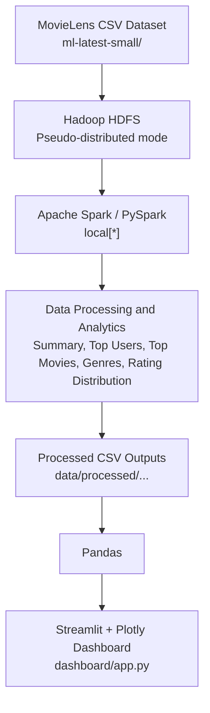
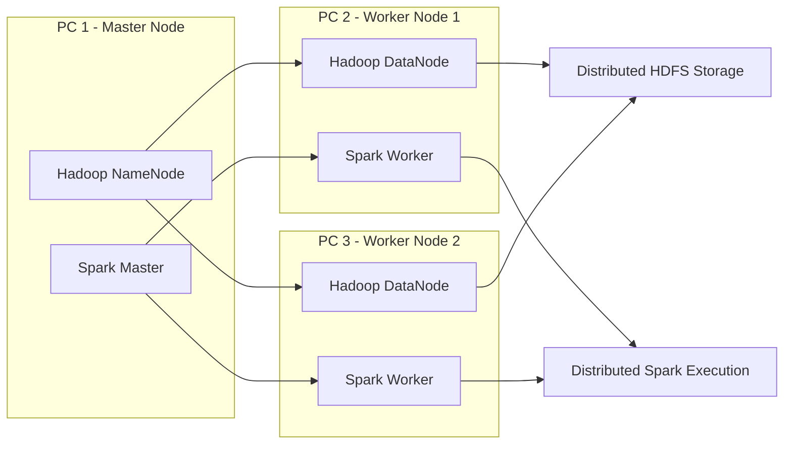

# MovieLens Movie Rating Analysis using Hadoop, Apache Spark and Streamlit

A Big Data Analytics project that processes the MovieLens Latest Small dataset using Hadoop HDFS and Apache Spark, then presents the results through an interactive dashboard built with Streamlit and Plotly.

This project is implemented as a practical end-to-end analytics pipeline on a single Ubuntu-based system running through WSL2, with Hadoop configured in pseudo-distributed mode and Spark using local execution (`local[*]`).

## Table of Contents

- [1. Project Overview](#1-project-overview)
- [2. System Architecture](#2-system-architecture)
- [3. Project Directory Structure](#3-project-directory-structure)
- [4. Dataset Description](#4-dataset-description)
- [5. Technology Installation and Configuration](#5-technology-installation-and-configuration)
- [6. Hadoop and HDFS Commands](#6-hadoop-and-hdfs-commands)
- [7. Apache Spark Implementation](#7-apache-spark-implementation)
- [8. Data Analytics Implemented](#8-data-analytics-implemented)
- [9. Actual Experimental Results](#9-actual-experimental-results)
- [10. Output Files](#10-output-files)
- [11. Streamlit Dashboard](#11-streamlit-dashboard)
- [12. Deployment](#12-deployment)
- [13. GitHub Commands](#13-github-commands)
- [14. Proposed Future Enhancements](#14-proposed-future-enhancements)
- [15. Conclusion](#15-conclusion)

---

## 1. Project Overview

This project analyzes movie ratings from the MovieLens dataset using big data technologies to demonstrate how large-scale data can be stored, processed, aggregated and visualized in a real-world analytics workflow. The system uses Hadoop HDFS to store the dataset, Apache Spark (PySpark) to perform distributed-style data processing, and a Streamlit dashboard with Plotly to visualize the results.

### Motivation

Recommendation platforms, content analytics systems, and entertainment applications rely heavily on user ratings to understand preferences, discover high-quality content and improve customer experience. This project demonstrates a practical implementation of that idea using a real-world public dataset and a simple data engineering pipeline.

### Problem Statement

The MovieLens dataset contains user rating behavior across many movies. The challenge is to process this data efficiently, derive useful insights, and present the findings in an accessible dashboard. The project addresses this by combining distributed storage, distributed processing and interactive analytics.

### Objectives

1. Store the MovieLens dataset in Hadoop HDFS.
2. Use Apache Spark to perform big-data transformations and aggregations.
3. Extract meaningful analytics such as top users, top movies and genre trends.
4. Export processed outputs as CSV files for downstream dashboarding.
5. Visualize results using a Streamlit dashboard with Plotly charts.
6. Create professional project documentation suitable for a B.Tech CSE Big Data Analytics project.

### Practical Applications

The techniques used here are relevant to several real-world use cases:

- Movie recommendation engines
- Streaming platform content analytics
- User engagement and rating analysis
- Genre performance evaluation
- E-commerce and product rating analytics in general

---

## 2. System Architecture

The project follows a straightforward data pipeline that matches the actual implementation in this workspace.

### Actual Implemented Architecture



### Role of Each Component

- MovieLens CSV Dataset: Source data files such as `ratings.csv`, `movies.csv`, `tags.csv`, and `links.csv`.
- Hadoop HDFS: Provides distributed-style storage for the raw dataset in the project pipeline.
- Apache Spark / PySpark: Performs aggregation, joining, filtering, grouping and export logic using DataFrames.
- Data Processing and Analytics: Produces statistics such as total ratings, average rating, top users, movie ratings and genre analysis.
- Processed CSV Outputs: Stores results in `data/processed/*` so they can be reused by the dashboard.
- Pandas: Reads exported CSV files for lightweight visual analysis in the dashboard.
- Streamlit + Plotly: Builds an interactive dashboard with KPI cards, filters and charts.

### Execution Context

This project is not running on a multi-node cluster. It is implemented on a single physical machine running Ubuntu through WSL2. Hadoop is configured in pseudo-distributed mode and Spark is executed in local mode using `local[*]`.

### Proposed Three-Node Distributed Architecture

The architecture below is a proposed extension for real distributed deployment. It has not been implemented in this project and should not be treated as a tested environment.



#### Proposed Configuration Approach

For a three-node deployment, the system would be structured as follows:

- PC 1: Master node running Hadoop NameNode and Spark Master.
- PC 2: Worker node 1 running Hadoop DataNode and Spark Worker.
- PC 3: Worker node 2 running Hadoop DataNode and Spark Worker.

Typical configuration tasks would include:

1. Configure hosts file on all machines.
2. Set up SSH key-based authentication.
3. Set `JAVA_HOME`, `HADOOP_HOME`, and `PATH` on each node.
4. Configure `core-site.xml`, `hdfs-site.xml`, and `mapred-site.xml` for cluster awareness.
5. Configure `workers` file with worker node hostnames.
6. Format NameNode once using `hdfs namenode -format`.
7. Start HDFS and YARN or Spark cluster services.

This is clearly labeled as a proposed extension and is not part of the current implementation.

#### Three-PC Setup Instructions

These steps describe a small cluster on three Ubuntu machines on the same trusted LAN. Run commands in the indicated place: **all PCs**, **PC 1 (master)**, or **PC 2/PC 3 (workers)**. Replace the example IP addresses and `YOUR_USER` with the actual LAN addresses and the same Linux account name on all three PCs. Reserve the addresses in your router or configure static addresses so the host mappings do not change.

Example names used below:

| PC | Hostname | Example IP | Services |
|---|---|---|---|
| PC 1 | `master` | `192.168.1.10` | HDFS NameNode, Spark Master |
| PC 2 | `worker1` | `192.168.1.11` | HDFS DataNode, Spark Worker |
| PC 3 | `worker2` | `192.168.1.12` | HDFS DataNode, Spark Worker |

##### 1. Prepare all three PCs

On **each PC**, install Java 17, SSH, Python and utilities, and set the machine's hostname to the matching name in the table (use `master`, `worker1`, or `worker2`):

```bash
sudo apt update
sudo apt install -y openjdk-17-jdk openssh-server python3 python3-venv python3-pip wget
sudo hostnamectl set-hostname master
sudo systemctl enable --now ssh
```

Change the final command on PC 2 to `sudo hostnamectl set-hostname worker1` and on PC 3 to `sudo hostnamectl set-hostname worker2`. Log out and back in if the shell still displays the old hostname.

On **each PC**, add the same host mappings. Substitute the actual addresses if they differ:

```bash
sudo tee -a /etc/hosts >/dev/null <<'EOF'
192.168.1.10 master
192.168.1.11 worker1
192.168.1.12 worker2
EOF

getent hosts master worker1 worker2
java -version
```

Confirm all three names resolve to the intended LAN addresses and that Java reports version 17.

##### 2. Install Hadoop on all three PCs

On **each PC**, download and unpack the same Hadoop version under the same account:

```bash
cd "$HOME"
wget https://dlcdn.apache.org/hadoop/common/hadoop-3.4.2/hadoop-3.4.2.tar.gz
tar -xzf hadoop-3.4.2.tar.gz
```

Add Hadoop and Java environment variables to `~/.bashrc` on **each PC**:

```bash
cat >> ~/.bashrc <<'EOF'
export JAVA_HOME=/usr/lib/jvm/java-17-openjdk-amd64
export HADOOP_HOME="$HOME/hadoop-3.4.2"
export HADOOP_CONF_DIR="$HADOOP_HOME/etc/hadoop"
export PATH="$PATH:$HADOOP_HOME/bin:$HADOOP_HOME/sbin"
EOF
source ~/.bashrc
hadoop version
```

The paths and account must be usable by Hadoop on every PC. If your Java installation uses another path, find its JDK directory with:

```bash
dirname "$(dirname "$(readlink -f "$(which java)")")"
```

Set `JAVA_HOME` to the directory printed by that command.

##### 3. Configure HDFS on PC 1 and copy the configuration

On **PC 1**, replace `YOUR_USER` below with the common Linux username. These settings designate PC 1 as the NameNode and PCs 2 and 3 as DataNodes; replication is set to two copies:

```bash
cat > "$HADOOP_HOME/etc/hadoop/core-site.xml" <<'EOF'
<configuration>
    <property>
        <name>fs.defaultFS</name>
        <value>hdfs://master:9000</value>
    </property>
</configuration>
EOF

cat > "$HADOOP_HOME/etc/hadoop/hdfs-site.xml" <<'EOF'
<configuration>
    <property>
        <name>dfs.replication</name>
        <value>2</value>
    </property>
    <property>
        <name>dfs.namenode.name.dir</name>
        <value>file:///home/YOUR_USER/hadoop_data/namenode</value>
    </property>
    <property>
        <name>dfs.datanode.data.dir</name>
        <value>file:///home/YOUR_USER/hadoop_data/datanode</value>
    </property>
</configuration>
EOF

printf '%s\n' 'worker1' 'worker2' > "$HADOOP_HOME/etc/hadoop/workers"
printf '\nexport JAVA_HOME=/usr/lib/jvm/java-17-openjdk-amd64\n' \
  >> "$HADOOP_HOME/etc/hadoop/hadoop-env.sh"
```

The NameNode and DataNode directories are local to the PC running each daemon; using the same path on all PCs is intentional. Create them on **each PC**, changing `YOUR_USER` as above:

```bash
mkdir -p "$HOME/hadoop_data/namenode" "$HOME/hadoop_data/datanode"
```

On **PC 1**, copy the shared Hadoop configuration to both workers:

```bash
scp "$HADOOP_HOME/etc/hadoop/core-site.xml" \
    "$HADOOP_HOME/etc/hadoop/hdfs-site.xml" \
    "$HADOOP_HOME/etc/hadoop/hadoop-env.sh" \
    YOUR_USER@worker1:"$HOME/hadoop-3.4.2/etc/hadoop/"
scp "$HADOOP_HOME/etc/hadoop/core-site.xml" \
    "$HADOOP_HOME/etc/hadoop/hdfs-site.xml" \
    "$HADOOP_HOME/etc/hadoop/hadoop-env.sh" \
    YOUR_USER@worker2:"$HOME/hadoop-3.4.2/etc/hadoop/"
scp "$HADOOP_HOME/etc/hadoop/workers" \
    YOUR_USER@worker1:"$HOME/hadoop-3.4.2/etc/hadoop/"
scp "$HADOOP_HOME/etc/hadoop/workers" \
    YOUR_USER@worker2:"$HOME/hadoop-3.4.2/etc/hadoop/"
```

##### 4. Enable SSH from PC 1 to both workers

On **PC 1**, generate an SSH key if one does not already exist, install its public key on both workers, and verify passwordless login. Enter each worker account password when `ssh-copy-id` requests it:

```bash
test -f ~/.ssh/id_ed25519 || ssh-keygen -t ed25519 -N "" -f ~/.ssh/id_ed25519
ssh-copy-id YOUR_USER@worker1
ssh-copy-id YOUR_USER@worker2
ssh YOUR_USER@worker1 hostname
ssh YOUR_USER@worker2 hostname
```

Hadoop's start/stop scripts use SSH to manage remote daemons. Ensure `sshd` is running on all PCs and the same account can write to its Hadoop data and log directories.

##### 5. Start and check HDFS

On **PC 1 only**, format the NameNode once for a brand-new cluster, then start HDFS:

```bash
hdfs namenode -format
start-dfs.sh
jps
hdfs dfsadmin -report
```

Do **not** format the NameNode again after the cluster contains data; formatting replaces its filesystem metadata. `jps` on PC 1 should show a NameNode and DataNode, and on each worker a DataNode. The HDFS report should show two live DataNodes. The NameNode web page is `http://master:9870`.

##### 6. Install and start Spark standalone

Spark must be installed at the same path and version on all three PCs. Use a Spark distribution whose version matches the PySpark version used to submit the job. The following example matches the PySpark version listed in this README; if that release is unavailable from the Apache download mirror, choose an available Spark release and install the matching PySpark version on every machine.

On **each PC**, download and unpack the same Spark distribution:

```bash
cd "$HOME"
wget https://dlcdn.apache.org/spark/spark-4.3.0/spark-4.3.0-bin-hadoop3.tgz
tar -xzf spark-4.3.0-bin-hadoop3.tgz
```

Add Spark and Python settings to `~/.bashrc` on **each PC**. Use the actual project path on each machine; this example assumes the project and virtual environment exist under `$HOME/MovieLensProject`:

```bash
cat >> ~/.bashrc <<'EOF'
export SPARK_HOME="$HOME/spark-4.3.0-bin-hadoop3"
export PATH="$PATH:$SPARK_HOME/bin:$SPARK_HOME/sbin"
export PYSPARK_PYTHON="$HOME/MovieLensProject/.venv/bin/python"
export HADOOP_CONF_DIR="$HOME/hadoop-3.4.2/etc/hadoop"
EOF
source ~/.bashrc
```

Create the project virtual environment and install PySpark on **each PC** (copy or clone the project to the same path on all three first):

```bash
cd "$HOME/MovieLensProject"
python3 -m venv .venv
source .venv/bin/activate
pip install pyspark==4.3.0
```

On **PC 1**, also install the dashboard dependencies in the same environment:

```bash
source "$HOME/MovieLensProject/.venv/bin/activate"
pip install streamlit plotly pandas
```

On **PC 1**, start the Spark Master:

```bash
start-master.sh --host master --port 7077 --webui-port 8080
```

On **PC 2**, start its Spark Worker:

```bash
start-worker.sh spark://master:7077
```

Run the same `start-worker.sh` command on **PC 3**. Check the Spark Master UI at `http://master:8080`; it should list two workers. Start the master and workers after each reboot, or configure them as managed services for a persistent deployment. To stop the daemons, run `stop-worker.sh` on each worker and `stop-master.sh` on PC 1; stop HDFS from PC 1 with `stop-dfs.sh`.

##### 7. Network and firewall checks

All PCs must be able to reach one another over the LAN. HDFS uses NameNode RPC/web ports 9000/9870 and DataNode ports 9864, 9866 and 9867; Spark uses Master RPC/web ports 7077/8080 and worker/executor ports. Spark worker/executor ports can be dynamic, so a restrictive firewall also needs fixed Spark port configuration and matching rules. For a trusted, isolated LAN only, a simple UFW rule is to allow traffic from the cluster subnet on **each PC** (replace the example subnet if needed):

```bash
sudo ufw allow from 192.168.1.0/24
sudo ufw status
```

This allows all ports from that subnet; do not use it on an untrusted network or expose cluster services to the public internet.

##### 8. Copy the dataset and run the analytics

Run these commands on **PC 1**, from the repository root, after HDFS and Spark are running:

```bash
cd "$HOME/MovieLensProject"
hdfs dfs -mkdir -p /movielens
hdfs dfs -put -f ml-latest-small/ratings.csv /movielens/
hdfs dfs -put -f ml-latest-small/movies.csv /movielens/
hdfs dfs -ls /movielens
```

Before submitting, update `src/ratings_analysis.py` for cluster execution: replace `.master("local[*]")` with the master URL `spark://master:7077`, replace its `hdfs://localhost:9000/...` input URIs with `hdfs://master:9000/...`, and write the outputs to a shared destination such as HDFS if they must be read by the dashboard on PC 1. The current script is explicitly configured for one machine: it hard-codes local Spark mode, uses `localhost` for HDFS, and writes output to a local path. Infrastructure setup alone does not make that script distributed.

After adapting the script and ensuring its output location is accessible to the dashboard, submit it from **PC 1**:

```bash
cd "$HOME/MovieLensProject"
source .venv/bin/activate
spark-submit --master spark://master:7077 --deploy-mode client src/ratings_analysis.py
```

The driver runs on PC 1 in client mode. Keep the project, Python environment, and any local dashboard output path available there. For a dashboard on PC 1, start it there after the analytics job completes:

```bash
streamlit run dashboard/app.py
```

Review the Spark Master UI and the application output for execution status. This setup section is a deployment guide, not a claim that the three-PC cluster has been run or tested for this repository.

---

## 3. Project Directory Structure

The repository structure in this implementation is as follows:

```text
MovieLensProject/
├── dashboard/
│   └── app.py
├── src/
│   └── ratings_analysis.py
├── data/
│   └── processed/
│       ├── summary/
│       ├── top_users/
│       ├── top_movies/
│       ├── genre_stats/
│       └── rating_distribution/
├── ml-latest-small/
│   ├── README.txt
│   ├── ratings.csv
│   ├── movies.csv
│   ├── tags.csv
│   └── links.csv
├── .gitignore
├── README.md
├── hadoop-3.4.2/               # excluded from Git via .gitignore
├── hadoop-3.4.2.tar.gz         # excluded from Git via .gitignore
├── .venv/                       # excluded from Git via .gitignore
└── ml-latest-small.zip          # source archive kept locally
```

### Purpose of Important Files and Folders

- `dashboard/app.py`: Streamlit dashboard that renders KPI cards, filters and charts.
- `src/ratings_analysis.py`: Spark-based analytics job that reads data from HDFS, computes insights and writes results to `data/processed`.
- `data/processed/`: Directory containing the processed analytics outputs used by the dashboard.
- `ml-latest-small/`: Local raw dataset extracted from the MovieLens Small dataset.
- `.gitignore`: Excludes local environment folders, Hadoop installation content, logs and secrets from Git.
- `README.md`: Project documentation.

Note: A committed `requirements.txt` file is not present in the current repository snapshot. Dependencies are therefore installed in the virtual environment using the commands shown later in this document.

---

## 4. Dataset Description

The project uses the MovieLens Latest Small dataset provided by GroupLens. It contains 100,836 ratings applied by 610 users across 9,742 movies.

### Dataset Files

#### `ratings.csv`

Each row contains a user rating for a movie.

Columns:

- `userId`: Unique user identifier
- `movieId`: Unique movie identifier
- `rating`: Rating on a 0.5 to 5.0 scale in 0.5 increments
- `timestamp`: Unix timestamp (seconds since epoch)

These records are the main data source for computing average ratings, user activity and distribution.

#### `movies.csv`

Each row contains metadata for a movie.

Columns:

- `movieId`: Unique movie ID
- `title`: Movie title and release year
- `genres`: Pipe-separated genres such as `Drama|Comedy|Romance`

This file is used to join movie metadata to rating records for movie-level analytics and genre analysis.

#### `tags.csv`

Each row represents a tag assigned by a user to a movie.

Columns:

- `userId`: User who created the tag
- `movieId`: Tagged movie
- `tag`: Tag text (short description)
- `timestamp`: Tag timestamp

This file is not used in the analytics implemented here, but it provides metadata about user interactions with movies.

#### `links.csv`

Each row links a MovieLens movie to external identifiers.

Columns:

- `movieId`: MovieLens identifier
- `imdbId`: IMDb identifier
- `tmdbId`: TMDb identifier

This file enables cross-referencing with external movie databases.

### Relationship Between Data Fields

The key relationship is:

- `userId` identifies the person who rated a movie.
- `movieId` identifies the movie being rated.
- `rating` is the score assigned by the user.
- `timestamp` records when the rating was submitted.
- `title` provides the movie's title and year.
- `genres` describes one or more categories for the movie.

The dataset is designed so that `ratings.csv` and `movies.csv` can be joined on `movieId`, enabling movie-specific analytics such as top-rated movies and genre profiles.

---

## 5. Technology Installation and Configuration

The project was developed on Ubuntu 24.04.5 LTS under WSL2. The setup steps below reflect the actual configuration style used for the project.

### A. Update Ubuntu

```bash
sudo apt update
sudo apt upgrade -y
```

This updates package lists and upgrades existing packages before installing Java and Hadoop dependencies.

### B. Install Java 17

```bash
sudo apt install openjdk-17-jdk -y
```

Java is required by Hadoop and JVM-based services.

### C. Check Java

```bash
java -version
javac -version
```

These commands confirm the Java JDK has been installed and configured correctly.

### D. Install SSH

```bash
sudo apt install openssh-server -y
```

SSH is used for communication between nodes in distributed systems and is also useful for secure cluster management.

### E. Download and Extract Hadoop 3.4.2

```bash
wget https://dlcdn.apache.org/hadoop/common/hadoop-3.4.2/hadoop-3.4.2.tar.gz
sudo tar -xzf hadoop-3.4.2.tar.gz -C /usr/local/
```

The local project contains an installed Hadoop directory named `hadoop-3.4.2`, which is excluded from Git by `.gitignore`.

### F. Configure `JAVA_HOME`, `HADOOP_HOME` and `PATH`

Add the following to `~/.bashrc`:

```bash
export JAVA_HOME=/usr/lib/jvm/java-17-openjdk-amd64
export HADOOP_HOME=/usr/local/hadoop-3.4.2
export PATH=$PATH:$HADOOP_HOME/bin:$HADOOP_HOME/sbin
```

Then apply the changes:

```bash
source ~/.bashrc
```

### G. Configure Hadoop Files

The project uses Hadoop in pseudo-distributed mode. The following configuration files are relevant:

- `core-site.xml`
- `hdfs-site.xml`
- `hadoop-env.sh`

Example configuration pattern:

```xml
<!-- core-site.xml -->
<configuration>
    <property>
        <name>fs.defaultFS</name>
        <value>hdfs://localhost:9000</value>
    </property>
</configuration>
```

```xml
<!-- hdfs-site.xml -->
<configuration>
    <property>
        <name>dfs.replication</name>
        <value>1</value>
    </property>
    <property>
        <name>dfs.namenode.name.dir</name>
        <value>/home/<your-user>/hadoop_data/namenode</value>
    </property>
    <property>
        <name>dfs.datanode.data.dir</name>
        <value>/home/<your-user>/hadoop_data/datanode</value>
    </property>
</configuration>
```

```bash
# hadoop-env.sh
export JAVA_HOME=/usr/lib/jvm/java-17-openjdk-amd64
```

The exact project values should match the local Hadoop installation used in this environment. For a clean pseudo-distributed setup, formatting the NameNode and starting services is required once during initial setup.

### H. Format NameNode, Start and Stop HDFS

Important: NameNode formatting should only be done once during initial setup, not repeatedly on an existing cluster.

```bash
hdfs namenode -format
start-dfs.sh
stop-dfs.sh
```

The first command initializes the filesystem metadata. The second command starts the HDFS daemons; the third stops them gracefully.

### I. Create Python Virtual Environment

```bash
python3 -m venv .venv
source .venv/bin/activate
```

This keeps the project dependencies isolated from the global Python environment.

### J. Install PySpark

```bash
pip install pyspark==4.3.0
```

This project uses PySpark with Spark configured to run in local mode.

### K. Install Dashboard Dependencies

```bash
pip install streamlit plotly pandas
```

The dashboard relies on `streamlit` for UI, `plotly` for interactive charts and `pandas` for reading processed CSV files.

### L. Configure `HADOOP_CONF_DIR`

When running Spark jobs that read from HDFS, it is often necessary to point Spark to Hadoop configuration files:

```bash
export HADOOP_CONF_DIR=$HADOOP_HOME/etc/hadoop
```

This ensures Spark can access HDFS-related configuration settings during runtime.

---

## 6. Hadoop and HDFS Commands

The following command reference is relevant to the project workflow and reflects the commands used in a pseudo-distributed setup.

| Command | Purpose | Explanation |
|---|---|---|
| `start-dfs.sh` | Start HDFS | Starts the Hadoop NameNode and DataNode services. |
| `stop-dfs.sh` | Stop HDFS | Stops the HDFS services cleanly before shutdown. |
| `jps` | Check Java processes | Lists active Java-based processes such as `NameNode` and `DataNode`. |
| `hdfs dfs -ls /` | List root HDFS directory | Shows files and directories stored in the distributed filesystem. |
| `hdfs dfs -mkdir -p /movielens` | Create directory | Creates the target folder used to store MovieLens data on HDFS. |
| `hdfs dfs -put ml-latest-small/ratings.csv /movielens/` | Upload file | Copies the ratings dataset into HDFS. |
| `hdfs dfs -put ml-latest-small/movies.csv /movielens/` | Upload file | Copies the movies dataset into HDFS. |
| `hdfs dfs -put ml-latest-small/tags.csv /movielens/` | Upload file | Copies the tags dataset into HDFS. |
| `hdfs dfs -put ml-latest-small/links.csv /movielens/` | Upload file | Copies the links dataset into HDFS. |
| `hdfs dfs -ls /movielens` | View uploaded files | Lists the files that were uploaded to the project folder. |
| `hdfs dfs -cat /movielens/ratings.csv` | Read file content | Prints the file contents from HDFS. |
| `hdfs dfs -get /movielens/ratings.csv .` | Download file | Retrieves a copy of the file to the local filesystem. |
| `hdfs dfs -du -h /movielens` | Check storage usage | Shows disk usage for the dataset stored in HDFS. |

### Example Workflow

```bash
start-dfs.sh
hdfs dfs -ls /
hdfs dfs -mkdir -p /movielens
hdfs dfs -put ml-latest-small/ratings.csv /movielens/
hdfs dfs -put ml-latest-small/movies.csv /movielens/
hdfs dfs -put ml-latest-small/tags.csv /movielens/
hdfs dfs -put ml-latest-small/links.csv /movielens/
hdfs dfs -ls /movielens
```

These commands create a storage area in HDFS and upload the project dataset before Spark analysis begins.

---

## 7. Apache Spark Implementation

### What is Apache Spark?

Apache Spark is a fast, distributed data processing engine designed for batch processing, stream processing and machine learning workloads. It provides a high-level API for large-scale analytics and is well suited for working with structured datasets such as the MovieLens ratings data.

### Why Spark Instead of Plain Python?

Processing millions of records in plain Python can become slow and memory constrained. Spark distributes the workload and handles large-scale data transformations efficiently using lazy evaluation, DataFrames and optimized execution plans.

### SparkSession

The script `src/ratings_analysis.py` starts a Spark session with:

```python
spark = SparkSession.builder \
    .appName("MovieLensRatingAnalysis") \
    .master("local[*]") \
    .getOrCreate()
```

This creates a Spark application that runs locally across available CPU cores.

### DataFrames

Spark DataFrames are structured tables used for reading, transforming and analyzing data. The project uses DataFrames to:

- Load CSV files from HDFS
- Join `ratings.csv` and `movies.csv`
- Group by user, genre and movie
- Aggregate averages and counts
- Export results to CSV

### Schema Inference

The project uses:

```python
.option("header", True) \
.option("inferSchema", True)
```

This tells Spark to read the first row as headers and infer the column types automatically.

### Transformations and Actions

The project uses multiple Spark operations:

- `groupBy`: group records by a column such as `userId` or `genre`
- `agg`: compute aggregate metrics such as average rating and count
- `avg`: calculate average rating values
- `count`: count the number of records
- `join`: combine ratings with movie metadata using `movieId`
- `explode`: expand a multi-value genre list into multiple rows
- `split`: split the `genres` string on pipe characters
- `filter`: keep only meaningful records
- `orderBy`: sort results by rating or counts

### Spark Execution Using `local[*]`

The job runs with `local[*]`, which tells Spark to use all available local cores in the current machine. This is appropriate for a single-machine pseudo-distributed environment and matches the project setup.

### Reading Data from HDFS

The source script reads CSV files directly from HDFS, for example:

```python
ratings = spark.read \
    .option("header", True) \
    .option("inferSchema", True) \
    .csv("hdfs://localhost:9000/movielens/ratings.csv")
```

This demonstrates how Spark reads raw data from the Hadoop filesystem before processing it.

### Actual Script Execution Command

```bash
python src/ratings_analysis.py
```

This command runs the analytics pipeline from the project root.

### Analytical Operations Implemented in the Source Code

The script performs the following steps:

1. Start a SparkSession.
2. Read ratings and movie CSV files from HDFS.
3. Compute total ratings count.
4. Compute overall average rating.
5. Count ratings per user and list the top users.
6. Join ratings with movies on `movieId`.
7. Compute movie-level average rating and rating count.
8. Filter movies with at least 50 ratings.
9. Split comma/pipe-separated genres and explode them into separate rows.
10. Compute average rating per genre.
11. Calculate summary counts for rating values from 0.5 to 5.0.
12. Write processed outputs into `data/processed/*`.
13. Stop the Spark session.

---

## 8. Data Analytics Implemented

This project implements five main analytics outputs.

### 1. Overall Summary

- Total ratings
- Overall average rating

This provides a quick overview of the dataset size and general audience sentiment.

### 2. Top Active Users

- Number of ratings given by each user
- Top 10 most active users

This identifies the users contributing the most ratings.

### 3. Highest-Rated Movies

- Average rating for each movie
- Total rating count
- Minimum 50 rating threshold
- Top 100 movies exported for display

This identifies movies that are both highly rated and popular enough to have substantial votes.

### 4. Genre-Wise Analysis

- Split `genres` into individual genre values
- Explode multiple genre values into separate records
- Compute average rating and count by genre

This analyzes which movie genres receive the strongest ratings.

### 5. Rating Distribution

- Frequency of ratings from 0.5 to 5.0

This shows how user ratings are distributed across the rating scale.

These analytics correspond directly to the generated outputs under `data/processed` and are used in the dashboard.

---

## 9. Actual Experimental Results

The values below are the actual results generated by the project code and verified against the dataset and output folders in this workspace.

### Summary Statistics

| Metric | Value |
|---|---:|
| Total Ratings | 100,836 |
| Overall Average Rating | 3.5016 |

### Top Active Users

| Rank | User ID | Total Ratings |
|---:|---:|---:|
| 1 | 414 | 2698 |
| 2 | 599 | 2478 |
| 3 | 474 | 2108 |
| 4 | 448 | 1864 |
| 5 | 274 | 1346 |
| 6 | 610 | 1302 |
| 7 | 68 | 1260 |
| 8 | 380 | 1218 |
| 9 | 606 | 1115 |
| 10 | 288 | 1055 |

### Top-Rated Movies (Minimum 50 Ratings)

| Rank | Movie | Average Rating | Rating Count |
|---:|---|---:|---:|
| 1 | The Shawshank Redemption (1994) | 4.4290 | 317 |
| 2 | The Godfather (1972) | 4.2891 | 192 |
| 3 | Fight Club (1999) | 4.2729 | 218 |
| 4 | Cool Hand Luke (1967) | 4.2719 | 57 |
| 5 | Dr. Strangelove or: How I Learned to Stop Worrying and Love the Bomb (1964) | 4.2680 | 97 |

### Highest-Rated Genres

| Rank | Genre | Average Rating | Rating Count |
|---:|---|---:|---:|
| 1 | Film-Noir | 3.9201 | 870 |
| 2 | War | 3.8083 | 4859 |
| 3 | Documentary | 3.7978 | 1219 |
| 4 | Crime | 3.6583 | 16681 |
| 5 | Drama | 3.6562 | 41928 |

### Rating Distribution

| Rating | Total Ratings |
|---:|---:|
| 0.5 | 1370 |
| 1.0 | 2811 |
| 1.5 | 1791 |
| 2.0 | 7551 |
| 2.5 | 5550 |
| 3.0 | 20047 |
| 3.5 | 13136 |
| 4.0 | 26818 |
| 4.5 | 8551 |
| 5.0 | 13211 |

---

## 10. Output Files

The Spark analytics job exports five processed result folders:

- `data/processed/summary/`
- `data/processed/top_users/`
- `data/processed/top_movies/`
- `data/processed/genre_stats/`
- `data/processed/rating_distribution/`

Each folder contains Spark-generated CSV output in a directory format rather than a single file. Typical output structure:

```text
data/processed/top_users/
├── _SUCCESS
└── part-00000-...csv
```

The `_SUCCESS` file confirms successful job completion, while `part-*.csv` stores the actual data.

### How the Dashboard Reads These Outputs

The dashboard uses Python `glob` and `pandas.read_csv` to load the output directories and read the generated CSV files.

```python
files = glob.glob(os.path.join(path, "part-*.csv"))
return pd.concat([
    pd.read_csv(file) for file in files
], ignore_index=True)
```

This allows the Streamlit app to read processed data without having to rerun the Spark job each time the dashboard loads.

---

## 11. Streamlit Dashboard

The dashboard entry point is:

```bash
streamlit run dashboard/app.py
```

This starts the app locally and typically serves it at:

[http://localhost:8501](http://localhost:8501)

### Implemented Dashboard Features

The dashboard in `dashboard/app.py` includes the following features:

- Four KPI metric cards
  - Total ratings
  - Total movies
  - Total users
  - Average rating
- Genre-wise average rating bar chart
- Rating distribution bar chart
- Highest-rated movies table
- Minimum rating-count slider filter
- Movie title search box
- Top 10 active users horizontal bar chart

### Dashboard Screenshots

Place actual screenshots in the repository and reference them with markdown image syntax, for example:

```markdown


```

Do not invent screenshot filenames or claim screenshots were captured if they were not generated.

---

## 12. Deployment

The dashboard is designed to be deployable on Streamlit Community Cloud, but a public deployment URL was not obtained in this workspace and therefore should not be claimed as complete.

### Deployment Steps

1. Create a public GitHub repository.
2. Push the project source code to GitHub.
3. Sign in to Streamlit Community Cloud.
4. Connect the GitHub repository.
5. Select `dashboard/app.py` as the application entry point.
6. Configure the Python environment and dependencies.
7. Deploy the app and obtain a public URL.

### Requirements for Deployment

The Streamlit dashboard reads the committed processed CSV outputs and extracted MovieLens files from the repository itself. It does not require a running local HDFS cluster to serve the dashboard content after the analytics outputs are already present.

### Common Deployment Issues

- Missing or incorrect package versions
- Entry point set to the wrong file
- Missing `requirements.txt` or incorrect dependency list
- Relative path issues when loading the data
- Large dependency installation time

This project currently uses direct package installation in the active environment rather than a committed `requirements.txt` file in the repository snapshot. If deploying to Streamlit Community Cloud, a `requirements.txt` should be generated and committed before deployment is attempted.

---

## 13. GitHub Commands

The following commands represent the standard Git workflow for this project.

```bash
git init
git status
git add .
git commit -m "Initial commit: MovieLens Big Data Analytics"
git branch -M main
git remote add origin <YOUR_GITHUB_REPOSITORY_URL>
git push -u origin main
```

### Explanation

- `git init`: initializes a new repository in the project folder.
- `git status`: checks tracked and untracked files.
- `git add .`: stages all files for commit.
- `git commit -m ...`: saves the current project state with a message.
- `git branch -M main`: renames the default branch to `main`.
- `git remote add origin ...`: links the repository to GitHub.
- `git push -u origin main`: pushes the code to the remote.

### Why `.gitignore` Is Important

The `.gitignore` file excludes:

- Virtual environment folders such as `.venv/`
- Hadoop installation archives and installation directories
- Local logs and temporary files
- Environment secrets such as `.env` files

This helps keep the repository clean and prevents large or sensitive local configuration files from being uploaded to GitHub.

---

## 14. Proposed Future Enhancements

The following items are future work and are not part of the implemented project results.

### Completed and Implemented Features

- Local HDFS-based data ingestion
- PySpark analytics processing
- Summary statistics generation
- Top-user analysis
- Top-movie analysis
- Genre analysis
- Rating distribution analysis
- Streamlit dashboard with Plotly visualizations

### Proposed Future Work

- Real three-node Hadoop and Spark cluster deployment
- Kafka integration for real-time movie-rating streams
- HBase for NoSQL storage and large-scale metadata management
- Advanced recommender systems using collaborative filtering
- Year-wise and temporal analysis of viewer behavior
- User-based and item-based collaborative filtering models

These features would extend the current project from a single-organization analytics demo into a more robust big data recommendation and monitoring platform.

---

## 15. Conclusion

This project demonstrates the end-to-end use of Hadoop HDFS, PySpark and Streamlit in building a practical big data analytics application. The MovieLens dataset is stored in HDFS, processed with Spark transformations and aggregations, and transformed into meaningful business insights such as overall ratings, top users, top movies and genre trends. The results are then presented through a user-friendly dashboard that allows the analyst to explore patterns visually.

The combination of distributed storage, distributed processing and interactive visualization is a strong representation of how modern big data systems are used in real-world analytics, recommendation systems and customer insight applications. This project provides a clear foundation for further advanced work in distributed analytics, recommendation engines and scalable data engineering pipelines.

---

## Final Note

This documentation reflects the actual implementation present in the repository at the time of creation, including the locally configured pseudo-distributed Hadoop setup, Spark `local[*]` execution, dashboard features and verified results from the current data outputs.
