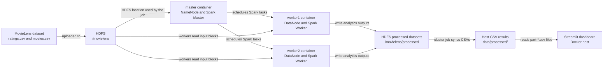

# MovieLens Movie Rating Analysis using Hadoop, Apache Spark, Docker, and Streamlit

This project uses MovieLens rating and movie metadata to demonstrate distributed storage with Hadoop HDFS, distributed analytics with Apache Spark, and interactive reporting with Streamlit. The Docker Compose setup runs a three-container Hadoop and Spark cluster on one Docker host; the containers simulate cluster nodes and are not separate physical computers.

## Table of Contents

- [Project Overview](#project-overview)
- [Key Features](#key-features)
- [System Architecture](#system-architecture)
- [Technology Stack](#technology-stack)
- [Dataset](#dataset)
- [Project Directory Structure](#project-directory-structure)
- [Hadoop HDFS Configuration](#hadoop-hdfs-configuration)
- [Docker-Based Cluster Setup](#docker-based-cluster-setup)
- [Running the Analytics](#running-the-analytics)
- [Analytics Results](#analytics-results)
- [Streamlit Dashboard](#streamlit-dashboard)
- [HDFS Replication and Verification](#hdfs-replication-and-verification)
- [Spark Cluster Verification](#spark-cluster-verification)
- [Troubleshooting](#troubleshooting)
- [Limitations and Future Enhancements](#limitations-and-future-enhancements)
- [Learning Outcomes](#learning-outcomes)

## Project Overview

Movie rating data can be analyzed to understand rating patterns, user activity, movie popularity, and genre-level trends. This project uses the MovieLens Latest Small dataset to demonstrate a data workflow in which CSV input files are stored in HDFS, Spark computes aggregate statistics, and the resulting CSV datasets are displayed by a Streamlit dashboard.

The application has two Spark execution modes:

- **Cluster mode** submits the PySpark job to the Spark standalone Master and its two Workers. It reads and writes data in HDFS, then copies the output datasets to the host's `data/processed/` directory for the dashboard.
- **Local mode** runs Spark with `local[*]` on the machine executing the Python process. It still reads input from HDFS, using `localhost:9000`, and writes output to a local directory. Local mode does not distribute work to the Docker Spark Workers.

The recommended end-to-end workflow is Docker cluster mode.

## Key Features

- Stores the input CSVs and analytics outputs in Hadoop HDFS.
- Runs one NameNode and two DataNodes.
- Runs an Apache Spark standalone Master and two Spark Workers.
- Uses Spark SQL/DataFrame transformations for rating and movie analytics.
- Writes five CSV outputs: `summary`, `top_users`, `top_movies`, `genre_stats`, and `rating_distribution`.
- Copies cluster-mode outputs from HDFS into `data/processed/` for the dashboard.
- Displays analytics with Streamlit, Pandas, and Plotly.
- Deploys the Hadoop and Spark services with Docker Compose.
- Configures HDFS replication factor 2 across the two DataNodes. This provides a second block replica while both DataNodes are available; it is not protection against loss of the entire Docker host or both volumes.

## System Architecture

The Compose services are named `master`, `worker1`, and `worker2` on a private bridge network. Streamlit runs separately on the Docker host and reads local CSV outputs.



The Spark Master schedules work; it is not itself a Spark Worker. Spark tasks on the Workers read input files from HDFS and write the analytics outputs back to HDFS. In cluster mode, the application synchronizes those HDFS outputs to the host-mounted `data/processed/` directory.

| Component | Responsibilities |
|---|---|
| `master` | Runs the HDFS NameNode and Spark Master; provides the HDFS and Spark web UIs and accepts job submissions. |
| `worker1` | Runs a DataNode and a Spark Worker. |
| `worker2` | Runs a DataNode and a Spark Worker. |
| HDFS | Stores the input CSVs and Spark output directories, with replication factor 2. |
| Spark standalone cluster | Schedules and executes the analytics job on the two configured Workers. |
| Streamlit | Reads the processed CSV files and local MovieLens data to render charts, tables, and KPI cards. |

These are three Docker containers on one machine. They demonstrate a multi-node service topology, not a deployment across three physical computers.

## Technology Stack

| Technology | Version or configuration | Where it is defined |
|---|---|---|
| Hadoop / HDFS | Hadoop 3.4.2 | `docker/Dockerfile` |
| Apache Spark | Spark 4.3.0, Hadoop 3 build | `docker/Dockerfile` |
| Java | OpenJDK 17 | `docker/Dockerfile` and Compose environment |
| Python | Python 3.12, `slim-bookworm` base image | `docker/Dockerfile` |
| PySpark | Spark's bundled PySpark runtime in the container; the analytics script imports PySpark | `docker/Dockerfile`, `src/ratings_analysis.py` |
| Docker Compose | Compose specification; the Compose CLI version is not pinned in this repository | `docker-compose.yml` |
| Streamlit | Declared in `requirements.txt`; version is not pinned | `requirements.txt` |
| Pandas | Declared in `requirements.txt`; version is not pinned | `requirements.txt`, `dashboard/app.py` |
| Plotly Express | Provided by the `plotly` dependency in `requirements.txt`; version is not pinned | `requirements.txt`, `dashboard/app.py` |

The container image installs Java, Hadoop, and Spark. The root `requirements.txt` contains the dashboard dependencies (`streamlit`, `pandas`, and `plotly`); it does not install PySpark for a host-based local analytics run.

## Dataset

The repository includes the MovieLens **Latest Small** dataset under `ml-latest-small/`. Its included `README.txt` identifies this development dataset as generated on September 26, 2018. It contains:

| File | Rows, excluding the header | Columns |
|---|---:|---|
| `ratings.csv` | 100,836 | `userId`, `movieId`, `rating`, `timestamp` |
| `movies.csv` | 9,742 | `movieId`, `title`, `genres` |
| `tags.csv` | 3,683 | `userId`, `movieId`, `tag`, `timestamp` |
| `links.csv` | 9,742 | `movieId`, `imdbId`, `tmdbId` |

The dataset README reports 610 users. The analytics job uses `ratings.csv` and `movies.csv`; it does not currently analyze `tags.csv` or `links.csv`. Movie genres are pipe-delimited in `movies.csv`. The supplied dataset documentation contains its license and citation information.

## Project Directory Structure

The following tree shows the source and runtime data used by the project. Part-file names are generated by Spark and can vary between runs.

```text
MovieLensProject/
├── config/
│   ├── core-site.xml
│   ├── hdfs-site.xml
│   └── workers
├── dashboard/
│   └── app.py
├── data/
│   └── processed/
│       ├── genre_stats/
│       ├── rating_distribution/
│       ├── summary/
│       ├── top_movies/
│       └── top_users/
├── docker/
│   ├── Dockerfile
│   ├── master-entrypoint.sh
│   └── worker-entrypoint.sh
├── ml-latest-small/
│   ├── README.txt
│   ├── links.csv
│   ├── movies.csv
│   ├── ratings.csv
│   └── tags.csv
├── src/
│   └── ratings_analysis.py
├── .dockerignore
├── .gitignore
├── docker-compose.yml
├── README.md
└── requirements.txt
```

The `.venv/`, `.git/`, local Hadoop installation files and archives, and the dataset ZIP archive are omitted from this tree. They are not required by the Compose workflow; the Dockerfile downloads Hadoop and Spark into the image, and the extracted dataset is already present in the repository.

## Hadoop HDFS Configuration

### Services and configuration files

- The NameNode manages the HDFS namespace and block metadata. It runs in `master`.
- Each DataNode stores HDFS blocks. They run in `worker1` and `worker2`.
- [`config/core-site.xml`](config/core-site.xml) sets `fs.defaultFS` to `hdfs://master:9000` and sets Hadoop's temporary directory to `/tmp/hadoop`.
- [`config/hdfs-site.xml`](config/hdfs-site.xml) sets the replication factor to 2, the NameNode and DataNode storage directories, the NameNode RPC address, and the NameNode/DataNode service addresses.
- [`config/workers`](config/workers) lists `worker1` and `worker2`.

The configured service ports are:

| Service | Port | Purpose |
|---|---:|---|
| NameNode RPC | 9000 | HDFS client and DataNode RPC access |
| NameNode HTTP | 9870 | NameNode web UI |
| DataNode transfer | 9866 | HDFS block transfer, internal to the Compose network |
| DataNode HTTP | 9864 | DataNode HTTP service, internal to the Compose network |
| DataNode IPC | 9867 | DataNode IPC, internal to the Compose network |

`docker-compose.yml` publishes NameNode RPC port 9000 and NameNode UI port 9870 on the host. DataNode ports are not published to the host; the cluster services communicate over the Compose network.

The Compose file defines named volumes `namenode-data`, `datanode1-data`, and `datanode2-data`. These keep HDFS metadata and block storage when containers are recreated. The master entrypoint formats a fresh, empty NameNode volume once. If it finds existing `current/VERSION` metadata, it leaves it unchanged; if it finds a non-empty directory without that metadata, it refuses to format.

### Upload the input files to HDFS

Start the Compose services first, then create the HDFS input directory and copy the two files used by the analytics job. The dataset directory is mounted read-only in the master container at `/workspace/ml-latest-small`.

```bash
# Create the input directory in HDFS.
docker compose exec master hdfs dfs -mkdir -p /movielens

# Copy the analytics input files from the mounted dataset into HDFS.
# -f replaces these HDFS destination files if they already exist.
docker compose exec master hdfs dfs -put -f \
  /workspace/ml-latest-small/ratings.csv \
  /workspace/ml-latest-small/movies.csv \
  /movielens/

# Confirm that both inputs are present.
docker compose exec master hdfs dfs -ls /movielens
```

The job reads `/movielens/ratings.csv` and `/movielens/movies.csv` in HDFS.

## Docker-Based Cluster Setup

### Prerequisites

- Git.
- Docker Engine or Docker Desktop with the Docker Compose v2 plugin (`docker compose`).
- Network access on the first image build so Docker can retrieve the configured Hadoop and Spark distributions.
- The host ports listed below must be available.

The MovieLens dataset is already included; a separate dataset download is not required.

### Clone and start the cluster

```bash
# Clone the repository into the expected project directory.
git clone https://github.com/JahnaviYelishala1/Big_data_MovieLens_rating_analysis.git MovieLensProject
cd MovieLensProject

# Build the Compose images.
docker compose build

# Start the cluster. Workers wait for the master health check to pass.
docker compose up -d

# Show service state and health.
docker compose ps -a
```

The first build downloads and installs the image's Java, Hadoop, and Spark dependencies and can take several minutes. Later starts can use the built images with `docker compose up -d`.

To inspect startup output:

```bash
docker compose logs --tail=100 master worker1 worker2
```

Wait until `master`, `worker1`, and `worker2` report healthy before submitting a cluster job. Both workers have `depends_on: master` with `condition: service_healthy`; each worker entrypoint also waits for the NameNode and Spark Master ports before starting its daemons.

### Services, resource limits, and host ports

| Compose service | Hadoop/Spark processes | Compose resource limit | Host port mapping |
|---|---|---|---|
| `master` | NameNode and Spark Master | 2 GiB memory, 1.5 CPUs | `9000:9000` NameNode RPC; `9870:9870` NameNode UI; `7077:7077` Spark RPC; `8080:8080` Spark Master UI |
| `worker1` | DataNode and Spark Worker | 2 GiB memory, 1 CPU; Spark Worker is configured for 1 core and 768 MiB | `8081:8081` Spark Worker UI |
| `worker2` | DataNode and Spark Worker | 2 GiB memory, 1 CPU; Spark Worker is configured for 1 core and 768 MiB | `8082:8081` host-to-container Spark Worker UI |

The Spark daemon memory settings in Compose are 256 MiB. The NameNode JVM option is configured as `-Xmx512m`. These are process settings in addition to the Compose container limits.

Open the UIs from the Docker host:

- Hadoop NameNode: [http://localhost:9870](http://localhost:9870)
- Spark Master: [http://localhost:8080](http://localhost:8080)
- Worker 1 Spark UI: [http://localhost:8081](http://localhost:8081)
- Worker 2 Spark UI: [http://localhost:8082](http://localhost:8082)

The HDFS and Spark RPC addresses used between containers are `hdfs://master:9000` and `spark://master:7077`. `localhost` on a worker container refers to that worker, not to the master.

Stop the containers while retaining their named HDFS volumes with:

```bash
docker compose down
```

## Running the Analytics

### Cluster mode (recommended)

1. Start the Docker cluster and wait for all services to become healthy.
2. Upload `ratings.csv` and `movies.csv` to HDFS using the commands in [Hadoop HDFS Configuration](#hadoop-hdfs-configuration).
3. Submit the application to the Spark standalone cluster:

```bash
docker compose exec \
  -e MOVIELENS_EXECUTION_MODE=cluster \
  -e MOVIELENS_OVERWRITE=true \
  master \
  spark-submit --master spark://master:7077 \
  /workspace/src/ratings_analysis.py
```

`MOVIELENS_EXECUTION_MODE=cluster` selects the `spark://master:7077` execution mode. `MOVIELENS_OVERWRITE=true` explicitly allows the job to replace existing output directories; omit it for a first run when the output paths do not already exist. By default, the job refuses to overwrite existing HDFS or local output data.

In cluster mode, the application:

1. Reads `hdfs://master:9000/movielens/ratings.csv` and `hdfs://master:9000/movielens/movies.csv`.
2. Runs Spark transformations on the standalone cluster.
3. Writes output datasets under `hdfs://master:9000/movielens/processed/`.
4. By default (`MOVIELENS_SYNC_OUTPUTS=true`), downloads each output directory into `/workspace/data/processed/`. That path is a Compose bind mount of the host's `data/processed/` directory, which the Streamlit app reads.

Set `MOVIELENS_SYNC_OUTPUTS=false` if the cluster job should leave results in HDFS without copying them to the host. To intentionally replace existing results, the overwrite flag must be set to the string `true`.

### Local Spark mode

Local mode runs Spark with `local[*]` on the machine running the Python process. It still expects the input files in HDFS at `hdfs://localhost:9000/movielens`; it does not use either Docker Spark Worker. The Compose master publishes port 9000 on the host, so the Docker cluster must be running and the HDFS input files must already be uploaded.

The host needs Java 17 and a PySpark installation compatible with Spark 4.3.0. The project's `requirements.txt` installs dashboard packages only; install PySpark separately for this mode. The script's local output path is hard-coded as `~/MovieLensProject/data/processed`, so keep the checkout at `~/MovieLensProject` for these commands to put results in the dashboard's expected directory.

```bash
cd ~/MovieLensProject
python3 -m venv .venv
source .venv/bin/activate
pip install -r requirements.txt
pip install pyspark==4.3.0

# Run locally using all available local Spark cores.
MOVIELENS_EXECUTION_MODE=local python src/ratings_analysis.py
```

For intentional replacement of existing local results, run:

```bash
MOVIELENS_EXECUTION_MODE=local MOVIELENS_OVERWRITE=true \
  python src/ratings_analysis.py
```

Local mode writes directly to `~/MovieLensProject/data/processed/`; it does not write the results to HDFS or perform the cluster-to-host sync. The dashboard can read these local outputs from the same directory.

### Analytics performed

The application in [`src/ratings_analysis.py`](src/ratings_analysis.py) reads CSV files with headers and infers their schemas. It computes:

- **Overall summary:** the average value of `rating`.
- **Most active users:** count of ratings grouped by `userId`, sorted descending; the output contains the top 10.
- **Highest-rated movies:** inner join of ratings and movies by `movieId`, then average rating and rating count per movie. Movies with fewer than **50 ratings** are excluded; the output contains up to 100 movies ordered by average rating descending.
- **Genre statistics:** splits the pipe-delimited `genres` column into individual genres, excludes `(no genres listed)`, and computes average rating and rating count per genre.
- **Rating distribution:** count of ratings for each rating value, ordered ascending.

Each output is written as a CSV with a header. The Spark writer coalesces each result to one `part-*.csv` file and also creates a `_SUCCESS` marker in its output directory.

## Analytics Results

The five result directories are:

| Output | CSV columns | Meaning |
|---|---|---|
| `summary` | `average_rating` | Overall mean rating. |
| `top_users` | `userId`, `total_ratings` | Ten users with the largest rating counts. |
| `top_movies` | `movieId`, `title`, `avg_rating`, `rating_count` | Up to 100 highest average-rated movies after the minimum 50-rating filter. |
| `genre_stats` | `genre`, `avg_rating`, `rating_count` | Per-genre mean rating and rating count. |
| `rating_distribution` | `rating`, `total_ratings` | Count of ratings at each rating value. |

Cluster-mode HDFS paths are `/movielens/processed/<output-name>/`. After the default synchronization, the local layout is `data/processed/<output-name>/part-*.csv`. The dashboard loads all `part-*.csv` files it finds in each output directory.

The currently generated results provide these examples:

- Overall average rating: **3.5015569836**.
- The most active user in the output is user ID `414` with **2,698** ratings.
- The first movie in the output is `Shawshank Redemption, The (1994)` with an average rating of **4.4290** from **317** ratings.
- The highest average-rated genre in the output is Film-Noir at **3.9201** across **870** ratings.

These are results from the included MovieLens dataset and current generated output files, not guaranteed metrics for a different dataset or modified inputs.

## Streamlit Dashboard

The Streamlit app is [`dashboard/app.py`](dashboard/app.py). It reads:

- The raw local `ml-latest-small/ratings.csv` and `ml-latest-small/movies.csv` for KPI cards.
- CSV part files from `data/processed/summary/`, `top_users/`, `top_movies/`, `genre_stats/`, and `rating_distribution/`.

The page provides total rating, movie, and user counts and the raw-data average rating; a genre average-rating bar chart; a rating distribution chart; a highest-rated movie table with a minimum-rating-count slider and title search; and a top-active-users chart. The top movie slider ranges from 50 to 300 ratings. The `summary` CSV is generated by the analytics job, while the dashboard's average-rating KPI is calculated from the raw ratings file.

Install the declared dashboard dependencies and launch the app from the repository root:

```bash
python3 -m venv .venv
source .venv/bin/activate
pip install -r requirements.txt
streamlit run dashboard/app.py
```

Streamlit normally serves the page at [http://localhost:8501](http://localhost:8501). Generate the processed outputs first to populate the charts and result table; the app reads raw data for the KPI cards.

## HDFS Replication and Verification

Use the following read-only commands to inspect the running cluster:

```bash
# Shows live DataNodes and HDFS storage/health summary.
docker compose exec master hdfs dfsadmin -report

# Shows the configured default replication factor (expected: 2).
docker compose exec master hdfs getconf -confKey dfs.replication

# Checks files, block locations, and filesystem integrity.
docker compose exec master hdfs fsck / -files -blocks -locations

# Shows the input and processed output paths.
docker compose exec master hdfs dfs -ls -R /movielens
```

For a focused check of the ratings file's block locations, use:

```bash
docker compose exec master \
  hdfs fsck /movielens/ratings.csv -files -blocks -locations
```

### Observed runtime verification

During a read-only check of the running project on **November 16, 2026**, `hdfs dfsadmin -report` showed **two live DataNodes** and `dfs.replication` returned **2**. `hdfs fsck / -files -blocks -locations` reported `Status: HEALTHY`, seven validated blocks, average block replication 2.0, and zero missing, corrupt, under-replicated, or over-replicated blocks.

That is a verified snapshot of the running environment, not a guarantee about a fresh installation. On a new cluster, upload the input files and run the analytics before expecting the same file and block counts. A missing DataNode or a file not yet uploaded will naturally produce different report totals.

## Spark Cluster Verification

Open the Spark Master UI at [http://localhost:8080](http://localhost:8080):

- The **Workers** section shows registered workers, their state, cores, and memory.
- The **Applications** section shows running and completed Spark applications.

The worker UIs are available at [http://localhost:8081](http://localhost:8081) and [http://localhost:8082](http://localhost:8082). The host maps worker 2's container port 8081 to host port 8082.

In the runtime check on **November 16, 2026**, the Spark Master UI reported two `ALIVE` workers, each with **1 core** and **768 MiB** of configured worker memory. It also showed the `MovieLensRatingAnalysis` application in `FINISHED` state. These are observed runtime results; a fresh cluster will show no completed application until a job is submitted.

## Troubleshooting

### A container is unhealthy or does not start

Check Compose state and service logs:

```bash
docker compose ps -a
docker compose logs --tail=200 master worker1 worker2
```

For the master's health-check history:

```bash
docker inspect --format '{{json .State.Health}}' master
```

The master check expects NameNode RPC at `master:9000`, Spark RPC at `master:7077`, and the local web UI ports 9870 and 8080, plus a successful `hdfs dfsadmin -report`. The entrypoint waits for the HDFS and Spark RPC endpoints before reporting startup complete. Check the first failing command in logs rather than repeatedly recreating containers.

### NameNode startup or metadata errors

Check the master log and effective HDFS addresses:

```bash
docker compose logs --tail=200 master
docker compose exec master hdfs getconf -confKey fs.defaultFS
docker compose exec master hdfs getconf -confKey dfs.namenode.rpc-address
docker compose exec master hdfs dfsadmin -report
```

The configured RPC endpoint is `master:9000`. The startup script preserves existing NameNode metadata; it formats only a fresh empty volume and refuses to format a non-empty directory without valid `current/VERSION` metadata. Do not remove the named volumes or manually reformat the NameNode as a troubleshooting shortcut.

### Workers are not registering

```bash
docker compose ps -a
docker compose logs --tail=200 worker1 worker2
docker compose exec master hdfs dfsadmin -report
```

Confirm that the master is healthy and that worker logs can reach `master:9000` and `master:7077`. Compose starts workers only after the master is healthy. Each worker then waits for both RPC ports and for its DataNode to register with HDFS before starting its Spark Worker.

### HDFS connection errors

Use the service name from inside Compose containers and the published localhost port from a host process:

- From a Compose container: `hdfs://master:9000`.
- From host-based local Spark mode: `hdfs://localhost:9000`.

Confirm the master is healthy, check port 9000, and verify that `/movielens/ratings.csv` and `/movielens/movies.csv` exist with `hdfs dfs -ls /movielens`. The input directory is not populated automatically; upload the files using the HDFS instructions above.

### Spark job fails or refuses to overwrite output

Review the Spark Master UI and the output from `spark-submit`. Confirm that both input files exist in HDFS and that the Spark Workers are `ALIVE`. By default, the job fails rather than replacing existing output paths. To rerun intentionally and replace existing HDFS and local output directories, set `MOVIELENS_OVERWRITE=true` on the job submission.

### Processed CSV files are missing

Check whether the HDFS output directories exist:

```bash
docker compose exec master hdfs dfs -ls -R /movielens/processed
```

Cluster-mode synchronization is enabled by default. If it was disabled, set `MOVIELENS_SYNC_OUTPUTS=true` on the next cluster run. If the outputs already exist, also set `MOVIELENS_OVERWRITE=true` to allow the job to regenerate and synchronize them. Confirm the host has `data/processed/<output-name>/part-*.csv` before starting the dashboard.

### Streamlit dependencies or paths fail

Run Streamlit from the repository root in an activated virtual environment and install the dependencies from `requirements.txt`. Confirm `ml-latest-small/ratings.csv`, `ml-latest-small/movies.csv`, and the processed output directories exist at the paths used by the app. For local analytics mode, also account for the script's fixed `~/MovieLensProject/data/processed` output path.

## Limitations and Future Enhancements

The current project is a batch analytics demonstration over the MovieLens Latest Small dataset. The three Compose services run on one Docker host; they are not physical servers. The application does not implement Kafka ingestion, HBase storage, streaming analytics, recommendation-model training, or deployment to a cloud platform. Local Spark mode is single-machine `local[*]`, not a distributed cluster run.

Possible future enhancements (not currently implemented) include:

- Kafka-based event ingestion and streaming analytics.
- HBase integration for serving or storing analytical data.
- Additional Docker workers and resource/scale experiments.
- Evaluations on larger MovieLens datasets.
- Additional analyses or dashboard filters and visualizations.

## Learning Outcomes

This project demonstrates practical concepts in:

- HDFS NameNode/DataNode roles, file storage, block replication, and filesystem health checks.
- Distributed processing with Spark DataFrames and a standalone Master/Worker topology.
- Submitting a PySpark job to a cluster and distinguishing it from local Spark execution.
- Moving data between a local dataset, HDFS, Spark output directories, and a dashboard-facing CSV directory.
- Container networking, health checks, persistent named volumes, resource limits, and service dependencies in Docker Compose.
- Building visual summaries from distributed batch-processing outputs with Streamlit, Pandas, and Plotly.
